<div align="center">


# Huella

**Red de adopción y rescate de mascotas para Colombia**

Adopción · Perdidos · Encontrados · Hogar temporal · Jornadas veterinarias

[](https://github.com/Casb29XD/Huellas/releases)
-3DDC84?logo=android&logoColor=white)


<br>

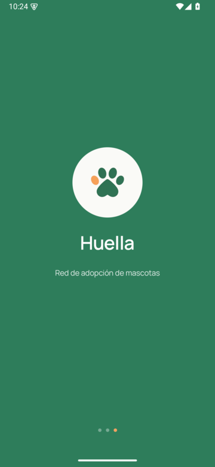
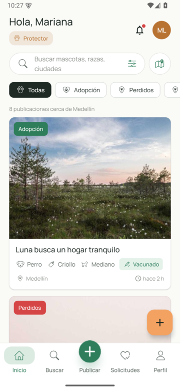
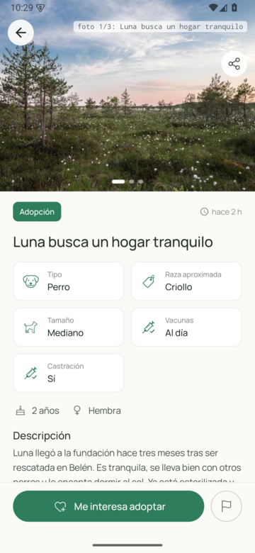
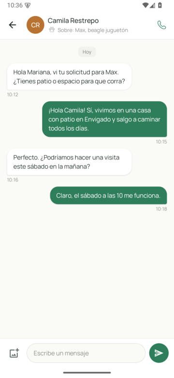
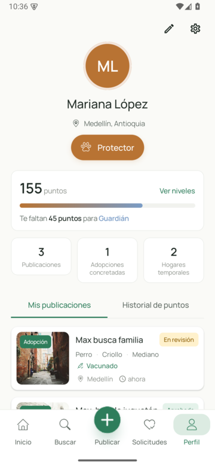

</div>

---

## Contenido

- [Qué es Huella](#qué-es-huella)
- [Funcionalidades](#funcionalidades)
- [Capturas](#capturas)
- [Arquitectura](#arquitectura)
- [Cómo funciona paso a paso](#cómo-funciona-paso-a-paso)
- [Tecnologías](#tecnologías)
- [Estructura del proyecto](#estructura-del-proyecto)
- [Empezar](#empezar)
- [Pruebas](#pruebas)
- [Backend Supabase](#backend-supabase)
- [Documentación](#documentación)
- [Equipo](#equipo)

## Qué es Huella

Huella conecta a rescatistas, hogares de paso y adoptantes responsables. Cada publicación pasa por un moderador
antes de ser pública, los interesados envían una solicitud formal en lugar de llamar a un teléfono expuesto, y
cuando el publicador acepta se abre un chat dentro de la app para coordinar la adopción.

**La venta de animales está prohibida.** La moderación (con ayuda de IA) existe para detectarla.

> La marca es **Huella** (singular): nombre de la app, paquete y deep link `huella://`. El repositorio se llama
> `Huellas` solo por historia.

## Funcionalidades

| | Funcionalidad | Detalle |
|---|---|---|
| 🔐 | **Cuenta** | Registro con correo o Google, verificación por correo, recuperación de contraseña (PKCE con deep link `huella://auth/confirm`) y borrado de cuenta. |
| 🏠 | **Inicio** | Lista de publicaciones aprobadas con búsqueda y filtros por categoría, especie, tamaño, ciudad, vacunados y esterilizados. |
| 🗺️ | **Mapa** | Vista de mapa con Google Maps para ver perdidos y encontrados cerca. |
| 📝 | **Publicar** | Asistente de 3 pasos: categoría y fotos, datos de la mascota, título, descripción y ciudad. |
| 🛡️ | **Moderación** | Toda publicación entra *En revisión*. Un moderador la aprueba o la rechaza con motivo obligatorio. |
| 🤖 | **IA para moderadores** | Botón *Analizar con IA*: DeepSeek da una segunda opinión (señales de venta, contenido inapropiado). Solo sugiere, decide la persona. |
| 🚩 | **Denuncias** | Cualquier usuario puede reportar una publicación; los reportes llegan al panel de moderación. |
| 📨 | **Solicitudes de adopción** | El interesado postula con un mensaje; el publicador acepta o rechaza desde *Solicitudes recibidas*. |
| 💬 | **Chat** | Al aceptar una solicitud se abre una conversación ligada a la publicación, sin exponer el teléfono. |
| 👀 | **Lo he visto** | Reporte de avistamiento en publicaciones de mascotas perdidas, con aviso al autor. |
| 🔔 | **Notificaciones** | Solicitudes nuevas, solicitudes aceptadas o rechazadas, publicación aprobada o rechazada, subida de nivel. |
| 🏆 | **Puntos y niveles** | El servidor da puntos por cada acción útil y calcula el nivel: Amigo Animal → Protector → Guardián → Héroe de las Mascotas. |
| 🌐 | **Dos idiomas** | Español e inglés. Tema claro y oscuro. |
| ⏰ | **Tareas automáticas** | Cierre de perdidos/encontrados después de 60 días y limpieza de avisos leídos después de 90. |

### Puntos

| Acción | Puntos |
|---|---|
| Crear una publicación | +5 |
| Publicación aprobada | +10 |
| Comentar (primer comentario en una publicación ajena) | +2 |
| Reportar un avistamiento | +5 |
| Adopción concretada (publicación finalizada) | +50 |

| Nivel | Puntos |
|---|---|
| Amigo Animal | 0 – 49 |
| Protector | 50 – 199 |
| Guardián | 200 – 499 |
| Héroe de las Mascotas | 500 o más |

## Capturas

<table>
  <tr>
    <th>Bienvenida</th><th>Inicio de sesión</th><th>Registro</th><th>Inicio</th>
  </tr>
  <tr>
    <td>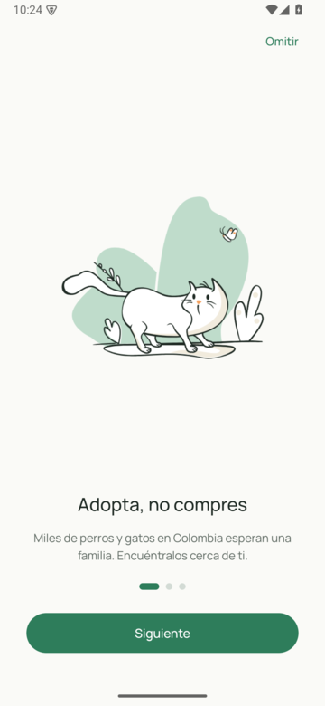</td>
    <td>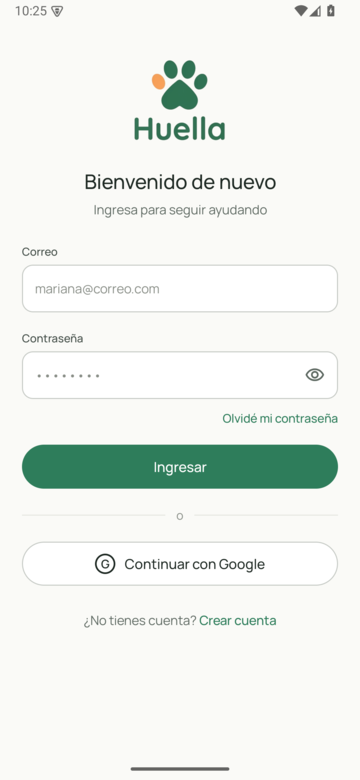</td>
    <td>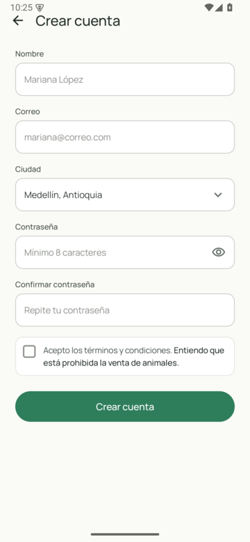</td>
    <td></td>
  </tr>
  <tr>
    <th>Filtros</th><th>Mapa</th><th>Detalle</th><th>Quiero adoptar</th>
  </tr>
  <tr>
    <td>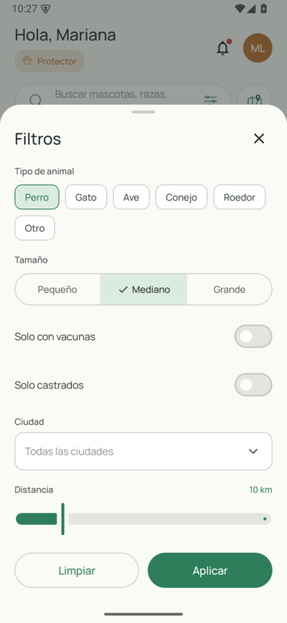</td>
    <td>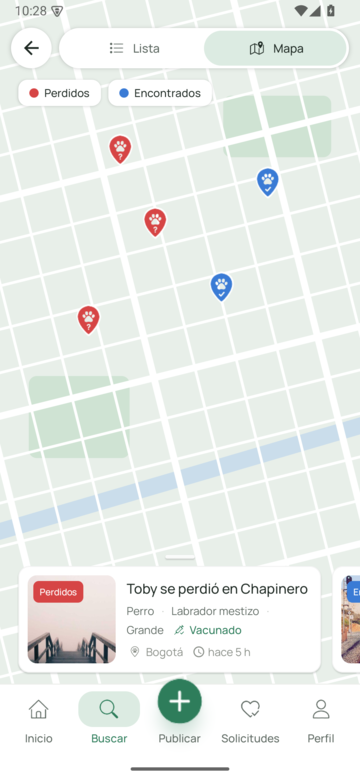</td>
    <td></td>
    <td>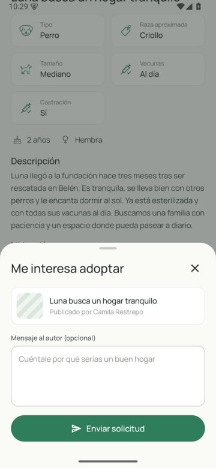</td>
  </tr>
  <tr>
    <th>Publicar (1/3)</th><th>Publicar (2/3)</th><th>Publicar (3/3)</th><th>Enviada a revisión</th>
  </tr>
  <tr>
    <td>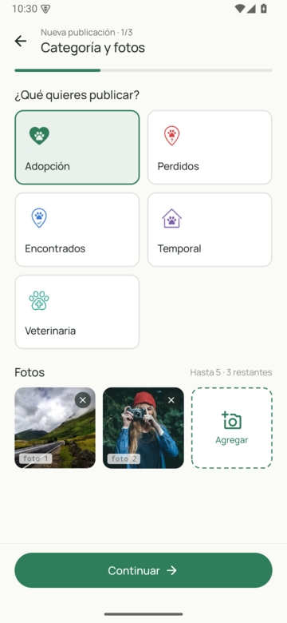</td>
    <td>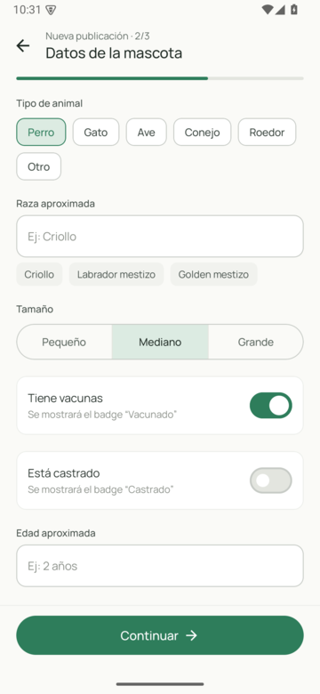</td>
    <td>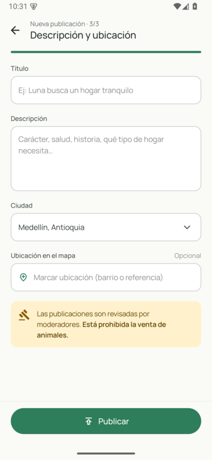</td>
    <td>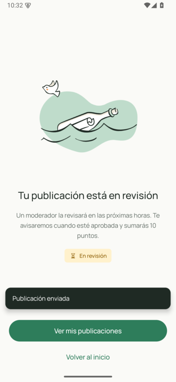</td>
  </tr>
  <tr>
    <th>Solicitudes recibidas</th><th>Chat</th><th>Notificaciones</th><th>Perfil</th>
  </tr>
  <tr>
    <td>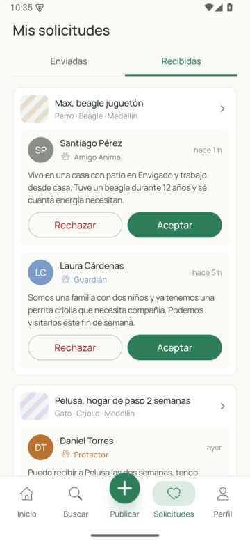</td>
    <td></td>
    <td>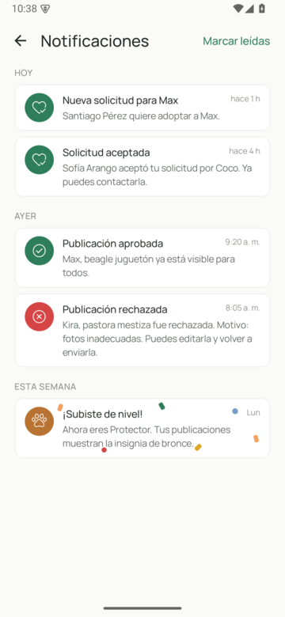</td>
    <td></td>
  </tr>
  <tr>
    <th>Niveles</th><th>Panel de moderación</th><th>Revisar publicación</th><th>Rechazar con motivo</th>
  </tr>
  <tr>
    <td>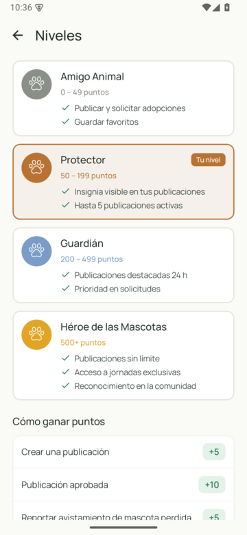</td>
    <td>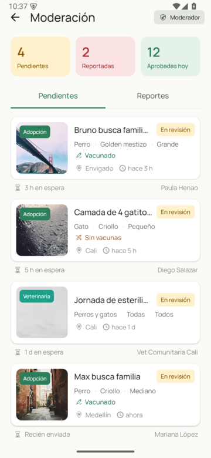</td>
    <td>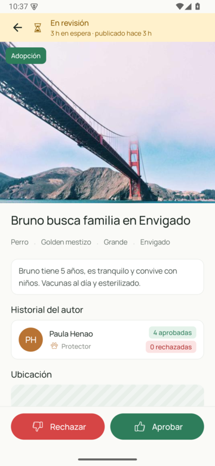</td>
    <td>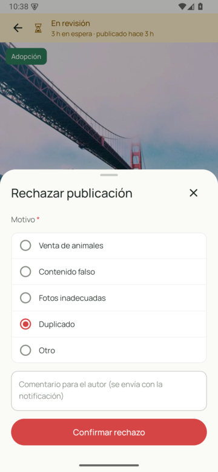</td>
  </tr>
</table>

<sub>Las capturas se tomaron con datos de demostración. Hay 44 en total en <a href="docs/screenshots">docs/screenshots</a>.</sub>

## Arquitectura

La app es una sola Activity con Jetpack Compose y patrón **MVVM**. No guarda datos de otros usuarios ni toma
decisiones importantes: roles, puntos, estados de publicación y avisos los decide **Supabase** con reglas RLS,
funciones RPC y triggers.

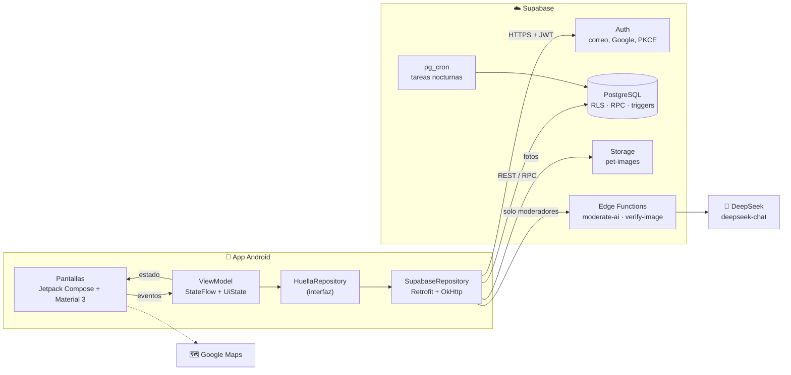

| Capa | Qué hace |
|---|---|
| **Pantallas** (`features/*`) | Dibujan el estado y envían los eventos del usuario al ViewModel. |
| **ViewModel** | Guarda el estado de la pantalla en un `StateFlow<UiState>` y llama al repositorio. |
| **HuellaRepository** | Interfaz con todo lo que la app puede pedir. En las pruebas se usa `FakeRepository`. |
| **SupabaseRepository** | Única implementación: Retrofit contra PostgREST, Auth y Storage. `SupabaseSession` guarda el token fuera del backup. |
| **Supabase** | Valida permisos con RLS, ejecuta la lógica de negocio en RPC y triggers, y guarda fotos y datos. |

## Cómo funciona paso a paso

### Ciclo de vida de una publicación

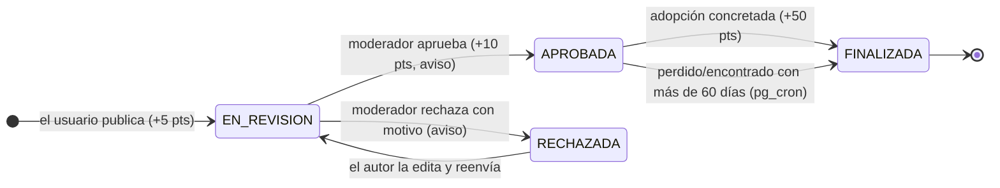

### Moderación con IA

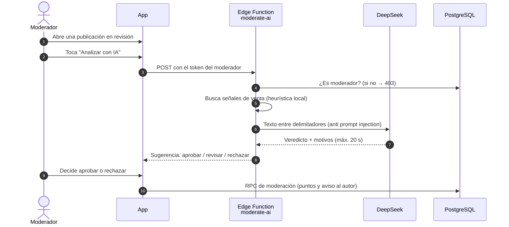

### Solicitud de adopción y chat

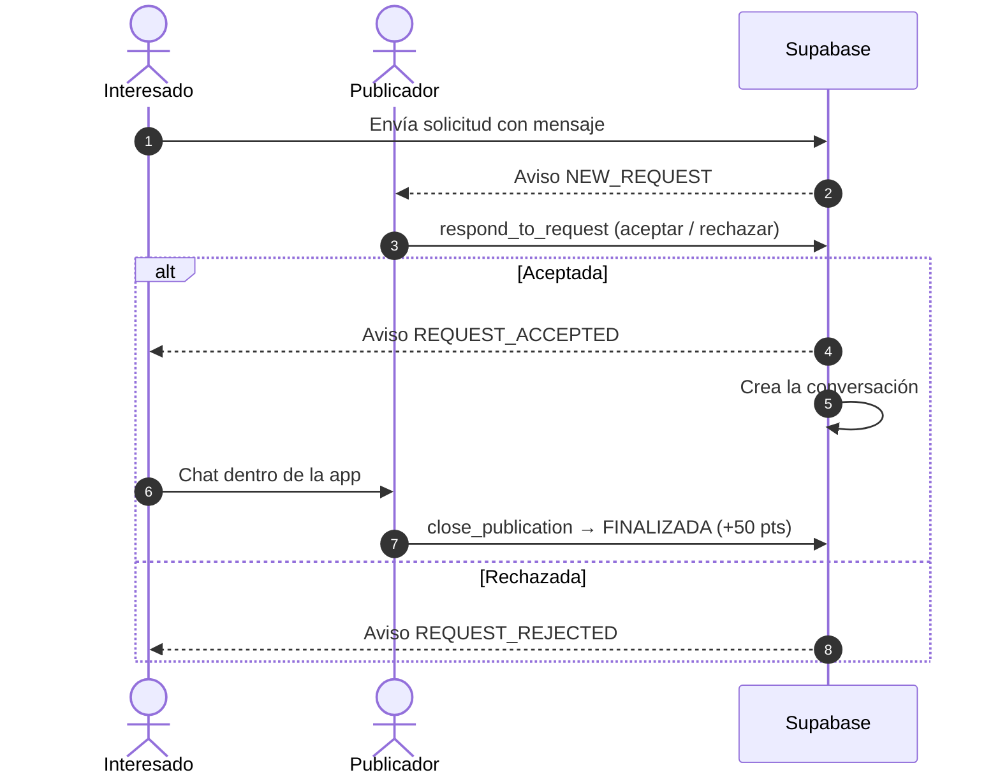

### Seguridad de una petición

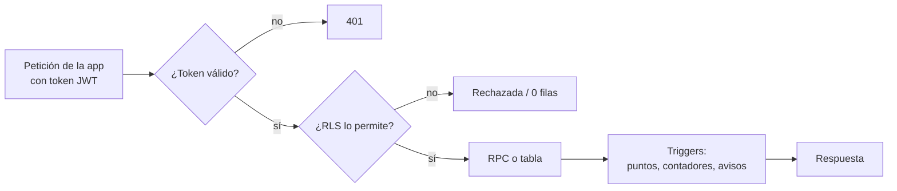

Lo que un usuario **no** puede hacer, aunque modifique la app: volverse moderador, cambiarse los puntos o el nivel,
aprobar sus propias publicaciones, leer el correo o el teléfono de otros, ni subir archivos fuera de su carpeta.
Cada uno de esos intentos está cubierto por una prueba automática (`RlsSecurityE2eTest`).

## Tecnologías

| Área | Tecnología |
|---|---|
| Lenguaje | Kotlin 2.2 |
| UI | Jetpack Compose (BOM 2026.02), Material 3, tema claro y oscuro |
| Navegación | Navigation Compose 2.9 con rutas type-safe (`@Serializable`) |
| Red | Retrofit 2.11, Gson, OkHttp 4.12 |
| Imágenes | Coil 3 |
| Mapas | Google Maps Compose 6.4 |
| Inicio de sesión con Google | Credential Manager |
| Backend | Supabase: Auth, PostgreSQL con RLS, Storage, Edge Functions (Deno), pg_cron |
| IA | DeepSeek `deepseek-chat`, elegida por costo (menos de 0,001 USD por análisis) |
| Pruebas | JUnit, Robolectric, compose-ui-test, MockWebServer, pgTAP, Deno test |
| Desarrollo | Android Studio, Claude Code |

## Estructura del proyecto

```
Huellas/
├── app/src/main/java/com/desarrolloMovielexample/huella/
│   ├── data/remote/      SupabaseRepository, SupabaseApiService (Retrofit), SupabaseSession, ModerationAiClient
│   ├── domain/           modelos, HuellaRepository y casos de uso
│   ├── features/         auth, feed, createpost, requests, profile, moderation, legal (pantalla + ViewModel)
│   └── navigation/       rutas type-safe y AppNavigation
├── app/src/test/         unitarias, Robolectric y E2E contra Supabase (FakeRepository vive aquí)
├── supabase/
│   ├── migrations/       esquema (fuente de verdad, append-only)
│   ├── functions/        moderate-ai, verify-image
│   └── tests/            pgTAP
├── docs/                 seguridad, pruebas, moderación IA, plantillas de correo y capturas
└── scripts/              Gradle nativo o en Docker, migraciones y pruebas remotas
```

## Empezar

### Requisitos

- JDK 17+ y Android SDK Platform 37 (Android Studio reciente con AGP 9.5). `minSdk 29`.
- Un proyecto de Supabase (o la CLI de Supabase con Docker para el entorno local).
- Git Bash o Linux para los scripts de `scripts/`.

### Configuración

1. Clona el repositorio:
   ```bash
   git clone https://github.com/Casb29XD/Huellas.git
   ```
2. Copia `app/.env.example` a `app/.env` (está en `.gitignore`) y completa:

   | Variable | Valor |
   |---|---|
   | `SUPABASE_URL` | `https://<project-ref>.supabase.co` (desde el emulador en local: `http://10.0.2.2:54321`) |
   | `SUPABASE_PUBLISHABLE_KEY` | La *publishable key* del proyecto. **Nunca** la `service_role`. |
   | `MAPS_API_KEY` | Opcional: Google Maps SDK para Android. |

   Sin `app/.env` la app arranca, pero las llamadas fallan con un mensaje que pide configurar esas variables.
3. Compila:
   ```bash
   scripts/gradle-native.sh :app:assembleDebug     # Gradle en el equipo
   scripts/gradle-docker.sh :app:assembleDebug     # o dentro de Docker, sin SDK instalado
   ```

## Pruebas

| Suite | Qué prueba | Resultado v1.0 |
|---|---|---|
| App (JUnit + Robolectric + E2E) | Casos de uso, endpoints, pantallas sin emulador y flujos reales contra Supabase | 119 pruebas en 30 clases, sin fallos |
| Base de datos (pgTAP) | RLS, puntos, solicitudes, chat y borrado de cuenta | 22 pruebas, 225 comprobaciones |
| Edge Functions (Deno) | `moderate-ai` y `verify-image` | 10 de 10 |

```bash
scripts/test-all.sh            # todo contra Supabase remoto, sin Docker
scripts/test-all.sh --local    # Supabase local con Docker
```

Las E2E crean sus propios usuarios y datos y los borran al terminar. Detalles en [docs/PRUEBAS.md](docs/PRUEBAS.md).

## Backend Supabase

<details>
<summary><b>Migraciones</b></summary>

El esquema vive solo en `supabase/migrations/` (append-only). Guía en [SUPABASE_MIGRATIONS.md](SUPABASE_MIGRATIONS.md).

```bash
supabase link --project-ref <project-ref> && supabase db push    # con la CLI
scripts/apply-migrations-remote.sh                               # alternativa por Management API, sin Docker
scripts/run-pgtap-remote.sh                                      # pgTAP contra el proyecto remoto
```
</details>

<details>
<summary><b>Edge Function <code>moderate-ai</code> (DeepSeek)</b></summary>

```bash
supabase functions deploy moderate-ai --use-api --project-ref <project-ref>
supabase secrets set DEEPSEEK_API_KEY=<tu-key> --project-ref <project-ref>
```

Sin `DEEPSEEK_API_KEY` responde `{"status":"not_configured"}` y el panel indica que la IA no está configurada.
Más detalles en [docs/MODERACION_IA.md](docs/MODERACION_IA.md).
</details>

<details>
<summary><b>Tareas programadas, Storage y Realtime</b></summary>

- **pg_cron** (horas UTC): `huellas_cierre_automatico` (08:00, finaliza perdidos y encontrados de más de 60 días) y
  `huellas_limpieza_notificaciones` (08:30, borra avisos leídos de más de 90 días).
- **Storage**: bucket público `pet-images`; cada usuario escribe solo en `<uid>/…`, máximo 5 MB, solo imágenes.
- **Realtime**: `chat_messages` y `notifications` están publicadas; la app todavía recarga al enviar o abrir la pantalla.
</details>

<details>
<summary><b>Auth: deep link y plantillas de correo</b></summary>

- Registro y recuperación de contraseña vuelven a la app por `huella://auth/confirm`. Agrega esa URL en
  *Authentication → URL Configuration → Redirect URLs*.
- Plantillas en `docs/email_templates/` (`confirm_signup.html`, `reset_password.html`): pégalas en
  *Authentication → Email Templates*.
- `supabase/seed.sql` crea usuarios de prueba **solo para el entorno local**.
</details>

## Documentación

| Documento | Contenido |
|---|---|
| [docs/SEGURIDAD_BACKEND.md](docs/SEGURIDAD_BACKEND.md) | Qué columnas y RPC puede usar el cliente |
| [docs/PRUEBAS.md](docs/PRUEBAS.md) | Batería de pruebas y cómo correrla |
| [docs/MODERACION_IA.md](docs/MODERACION_IA.md) | Moderación asistida con DeepSeek |
| [docs/MATRIZ_HALLAZGOS.md](docs/MATRIZ_HALLAZGOS.md) | Estado de cada hallazgo de la auditoría de seguridad |
| [DOCUMENTACION_PROYECTO_HUELLA.md](DOCUMENTACION_PROYECTO_HUELLA.md) | Necesidad adicional y decisiones de diseño |

## Equipo

| Integrante |
|---|
| Luis Carlos Calderon |
| Cristian Alejandro Sierra |
| Daniel Esteban Muñoz |

<div align="center">
<sub>Hecho con 🐾 en Colombia · Proyecto final de Desarrollo Móvil</sub>
</div>
