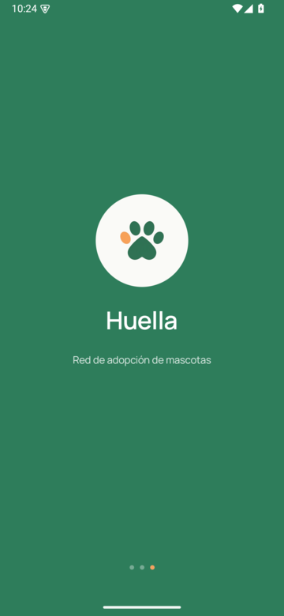
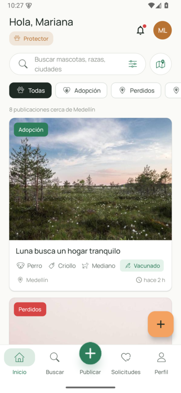
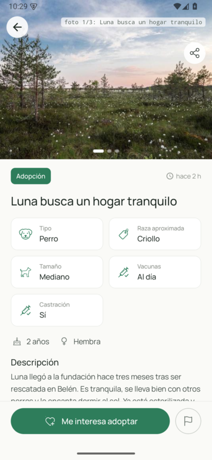
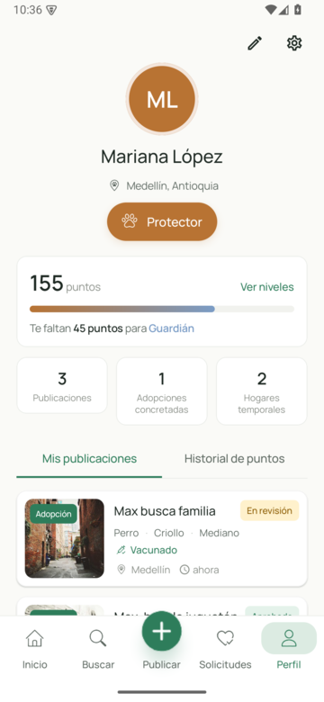

# Huella

App Android (Kotlin + Jetpack Compose) de una red de adopción de mascotas en Colombia: adopción, perdidos y
encontrados, hogar temporal y eventos veterinarios, con moderación previa de publicaciones, solicitudes de adopción,
chat entre adoptante y publicador, notificaciones y gamificación por puntos y niveles. El backend es **Supabase**
(Postgres + RLS, Auth, Storage, pg_cron y una Edge Function). La venta de animales está prohibida.

<p>
  
  
  
  
</p>

Las capturas de `docs/screenshots/` son del diseño y se tomaron con datos de demostración, no contra Supabase.

## Arquitectura

```
App Android (MVVM, una Activity)                 Supabase
┌──────────────────────────────┐   HTTPS   ┌─────────────────────────────────────────────┐
│ Pantallas Compose + ViewModel│──────────►│ Auth (GoTrue): email/contraseña, PKCE        │
│ StateFlow<UiState> + UiText  │  Retrofit │ PostgREST: tablas con RLS y RPC              │
│            │                 │           │ Storage: bucket pet-images                   │
│ HuellaRepository (interfaz)  │           │ Edge Function moderate-ai (DeepSeek)         │
│   └ SupabaseRepository       │           │ pg_cron: cierre automático y limpieza        │
│       SupabaseApiService     │           │ Triggers: puntos, notificaciones, contadores │
│       SupabaseSession (token)│           └─────────────────────────────────────────────┘
└──────────────────────────────┘
```

- `app/src/main/java/com/desarrolloMovielexample/huella/`
  - `data/remote/`: `SupabaseRepository` (única implementación de `HuellaRepository`), `SupabaseApiService`
    (Retrofit), `RetrofitClient`, `SupabaseSession` (token fuera del backup), `ModerationAiClient`.
  - `domain/`: modelos, `HuellaRepository` y casos de uso (`domain/usecase`).
  - `features/`: auth, feed, createpost, requests, profile, moderation y legal; cada pantalla con su ViewModel.
  - `navigation/`: rutas type-safe (`@Serializable`) y `AppNavigation`.
  - Textos en `res/values` (español) y `res/values-en` (inglés).
- `supabase/`: `config.toml`, `migrations/` (fuente de verdad del esquema), `tests/` (pgTAP),
  `functions/moderate-ai/`, `seed.sql` (solo desarrollo local).
- `app/src/test/`: unitarias, Robolectric + compose-ui-test y e2e contra Supabase (`e2e/*E2eTest`).
  `FakeRepository` (en memoria) vive solo aquí.
- Las reglas de negocio sensibles (roles, puntos, estados, notificaciones) están en el servidor; ver
  [docs/SEGURIDAD_BACKEND.md](docs/SEGURIDAD_BACKEND.md).

## Requisitos

- JDK 17+ y Android SDK Platform 37 (Android Studio reciente con soporte de AGP 9.4). minSdk 29.
- Un proyecto Supabase (hosted) o la CLI de Supabase con Docker para el stack local.
- Git Bash o Linux para los scripts de `scripts/`.

## Configurar la app

1. Copia `app/.env.example` a `app/.env` (ignorado por git) y completa:
   - `SUPABASE_URL`: `https://<project-ref>.supabase.co` (local desde el emulador: `http://10.0.2.2:54321`).
   - `SUPABASE_PUBLISHABLE_KEY`: la publishable key del proyecto (Dashboard > Project Settings > API).
     Nunca la service_role/secret.
   - `MAPS_API_KEY`: opcional, Google Maps SDK para Android.
2. Sin `app/.env` la app compila y arranca sin crashear; las llamadas fallan con
   "Configura SUPABASE_URL y SUPABASE_PUBLISHABLE_KEY en app/.env".

## Compilar y probar

```bash
scripts/gradle-native.sh :app:assembleDebug          # Gradle en el host (JAVA_HOME/ANDROID_HOME o toolchain portable)
scripts/gradle-native.sh :app:testDebugUnitTest      # unitarias + Robolectric (las e2e se saltan sin variables)
scripts/gradle-docker.sh :app:testDebugUnitTest      # lo mismo dentro de Docker, sin SDK en el host
```

Batería completa (pgTAP + JVM + e2e), detalles en [docs/PRUEBAS.md](docs/PRUEBAS.md):

```bash
scripts/test-all.sh          # hosted (por defecto): Supabase remoto, sin Docker
scripts/test-all.sh --local  # Supabase local con `supabase db reset` + Gradle en Docker
```

El modo hosted lee las variables de `.env.remote.example` desde un archivo **fuera del repo**
(`$HUELLAS_ENV`). Las e2e crean usuarios y datos con nombres únicos y los borran al terminar.

## Backend Supabase

### Migraciones

El esquema vive solo en `supabase/migrations/` (append-only). Guía corta en
[SUPABASE_MIGRATIONS.md](SUPABASE_MIGRATIONS.md).

```bash
supabase link --project-ref <project-ref> && supabase db push    # con la CLI
scripts/apply-migrations-remote.sh                               # alternativa por Management API, sin Docker
scripts/run-pgtap-remote.sh                                      # pgTAP contra el hosted
```

### Edge Function `moderate-ai`

Segunda opinión con DeepSeek para la cola de moderación; el veredicto es solo una sugerencia
(ver [docs/MODERACION_IA.md](docs/MODERACION_IA.md)).

```bash
supabase functions deploy moderate-ai --use-api --project-ref <project-ref>
supabase secrets set DEEPSEEK_API_KEY=<tu-key> --project-ref <project-ref>
```

Sin `DEEPSEEK_API_KEY` responde `{"status":"not_configured"}` y el detalle de moderación indica que la IA no está configurada.

### Cron jobs y Storage

- pg_cron (migración `20261109130000_ciclo_de_vida.sql`, horas UTC):
  `huellas_cierre_automatico` (08:00, finaliza perdidos/encontrados de más de 60 días) y
  `huellas_limpieza_notificaciones` (08:30, borra notificaciones leídas de más de 90 días).
- Bucket público `pet-images`: cada usuario escribe solo en `<uid>/…`, máximo 5 MB, solo imágenes
  (migración `20261109010400_storage_pet_images.sql`).
- Realtime: `chat_messages` y `notifications` están en la publicación `supabase_realtime`; la app todavía no se
  suscribe (recarga al enviar o al abrir la pantalla).

### Auth: deep link PKCE y plantillas de correo

- Registro y recuperación de contraseña usan PKCE y vuelven a la app por `huella://auth/confirm`; la app canjea
  el `code` y, si es recuperación, abre la pantalla de contraseña nueva.
- En el Dashboard (Authentication > URL Configuration) agrega `huella://auth/confirm` a Redirect URLs.
- Plantillas en `docs/email_templates/` (`confirm_signup.html`, `reset_password.html`, usan
  `{{ .ConfirmationURL }}`): pégalas en Authentication > Email Templates.
- `supabase/seed.sql` crea usuarios de prueba **solo para el stack local**; no lo ejecutes en un proyecto real.

## Más documentación

- [docs/SEGURIDAD_BACKEND.md](docs/SEGURIDAD_BACKEND.md): qué columnas y RPC ve el cliente.
- [docs/PRUEBAS.md](docs/PRUEBAS.md): batería de pruebas.
- [docs/MODERACION_IA.md](docs/MODERACION_IA.md): moderación asistida.
- [docs/MATRIZ_HALLAZGOS.md](docs/MATRIZ_HALLAZGOS.md): estado de cada hallazgo de la auditoría 2026-11.
- [DOCUMENTACION_PROYECTO_HUELLA.md](DOCUMENTACION_PROYECTO_HUELLA.md): necesidad adicional y decisiones.
